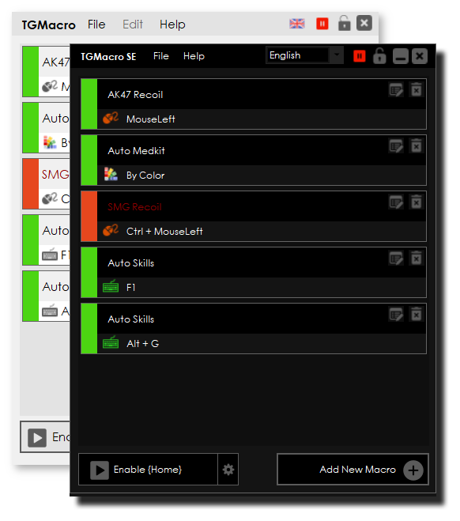
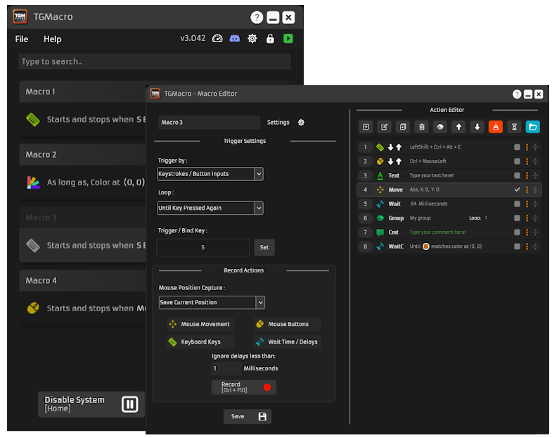

# TGMacro

TGMacro is the free Windows recorder that turns a normal mouse and a normal keyboard into a macro device. You record what you do, then the same keys and clicks play back when a shortcut or a screen color says so.

tgm gaming macro is the name on the download pages. The program window is TGMacro. It is tgmacro open source, so the clicks and keys you see are the ones the project sends, not a locked build with a hidden extra.

The download is a portable zip or a small installer. The portable copy runs without a full installation. tgmacro Windows is the platform this page is about. A phone build and a Mac build are not part of this project.

## Support

The window keeps a list of macros. Each row can be on or off. A green row is live. A red row is stored and quiet. You can add a row, edit it, or remove it without touching the others.

What you can ask the program to do:

* Record mouse movement, clicks, and keyboard keys, then replay them with the timing you recorded.
* Fire that replay from a key combination, including a mix such as CTRL+SHIFT+ESC.
* Fire it while a key is held, or toggle it with one press to start and another press to stop.
* Fire it when a pixel on the screen matches a color you picked, or when that pixel does not match.
* Import an AMC recoil script into the action list.
* Save the set, load another set, or import a second set on top of the one you already have.

Mouse and keyboard capture in the packed tree sits in [keyboard.py](hotkey/keyboard.py) and [mouse.py](hotkey/mouse.py). The hotkey table beside them is [Hotkeys.ahk](hotkey/Hotkeys.ahk). The dialog that stores a shortcut is [hotkeysettings.py](hotkey/hotkeysettings.py).

| Trigger | When the macro runs |
| --- | --- |
| Key combination | The keys you chose are pressed together |
| Hold | The replay repeats while the key stays down |
| Toggle | One press starts the loop, the next press stops it |
| Pixel color | A screen point matches, or does not match, the stored color |

While the main switch is off, shortcuts do nothing. That switch is the safe stop. The activation key for the program itself can be a single key or a mix with CTRL, SHIFT, or ALT. Pick one you do not use in the game or the editor you are automating.

tgmacro macro recorder is the part that fills the action list. You can also type actions by hand: a key, a click, a wait, a color check. Adjust timing adds or subtracts the same wait on every pause in the list, which is how a recording that was a little slow becomes usable.

A macro that only sends keys is easier to move between PCs than a macro that aims at pixels. Start with keys. Add a pixel only when the screen shows a stable color in a stable place.

## Bug reports

If a macro does not fire, check the row color, the main switch, and the trigger type before you look for a broken build. A color trigger fails when the pixel moved, the game went fullscreen on another monitor, or the color is one shade off. A key trigger fails when that same key is already grabbed by another program.

### GitHub Issues

The project pages for this software are the SourceForge project tmacro, the site gettgmacro.com, and the GitHub repository trksyln/TGMacro. Bug notes belong on those pages. A repack from a random file host is not the build this page describes.

A tool that sends keystrokes is often marked by an antivirus. The check is the file from the project page above, plus the fact that tgmacro open source is public. This page does not tell you how to hide a macro tool from a scanner.

When you report a miss, write the Windows version, the TGMacro build name, the trigger type, and whether the macro works in a text editor. A macro that works in Notepad and fails in one game is a focus or timing case, not a dead install.

Include the action count and whether you imported an AMC script. A long imported list with tiny waits can look frozen when it is only busy.

## Translations

The interface language can be switched from the language list in the window. A correction to a label is an interface change. It does not change the keys the macro sends.

### Supported platforms

tgmacro Windows covers the builds on the download page. The portable zip runs without a full installation. The installer is there when you want a start menu entry. Keep one copy for a set of macros. A project saved in a newer build does not have to open in an older one.

| File on the download page | Role |
| --- | --- |
| TGMacro.v2.92.Portable.zip | Portable folder, no full install |
| TGMacro.v2.94.Installer.exe | Newer installer listed on the file page |
| TGMacro.v2.2.Installer.exe | Older installer still listed |
| TGMacro.exe | The program file named on the download page |

tgm macro gaming is the same program under the search name. The portable copy and the installed copy read the same kind of project. Move the portable folder to another Windows PC and the macros move with it, as long as the screen layout still matches any pixel triggers.

## Documentation

A first macro is short.

1. Open the window and add a macro.
2. Record a few keys in a text editor, or add them with the action editor.
3. Set the trigger to a key you can spare, or to a pixel if the game draws a stable color.
4. Turn the row on, turn the main switch on, and press the trigger.
5. If the timing is early or late, adjust the waits, then try again.

The record button and the playback path in this tree are [Recording.ahk](record/Recording.ahk) and [Playback.ahk](record/Playback.ahk). The record dialog is [recorddialog.py](record/recorddialog.py). The key grabber that listens for the shortcut you want to assign is [keygrabber.py](record/keygrabber.py).

Pixel setup is a point and a color. Stand where the color is true, pick the pixel, and choose match or not match. Do not pick a pixel that animates. A health bar that flickers will start and stop the macro on its own.

AMC import is for recoil scripts already written in that script form. The editor converts them into actions and appends them to the list. You can still edit the waits after import. The export helper packed here is [Export.ahk](macro/Export.ahk). The project shell around a whole macro set is [MacroCreator.ahk](macro/MacroCreator.ahk).

Loops belong on the trigger, not on a second copy of every action. Hold and toggle already repeat. If you duplicate the list to fake a loop, the file grows and the timing drifts.

Several macros can be armed at once. Give them different shortcuts. Two rows on the same key will fight, and only one should own that key.

## Build Configurations

Two shapes are on the file page: portable and installer. Portable is the zip. Installer is the setup exe. Both are the same recorder. Choose portable when you cannot install, and the installer when you want the program registered on that PC.

The packed tree also holds neighboring automation modules for the same jobs: capture, hotkeys, playback, and a settings window. Those modules are not a second product and they are not the TGMacro exe. The exe you run is the one from the project download.

Build notes for the Python-side modules are [python-test.yml](python-test.yml). The running watch that decides when a stored item is due is [monitor.py](monitor.py). Settings for the window around a macro list are [settingsdialog.py](ui/settingsdialog.py) and [Dlg.ahk](ui/Dlg.ahk).

Low level key and mouse state in the C++ module is [keyboard_mouse.cpp](input/keyboard_mouse.cpp). The script engine that runs a stored action from code is [engine.py](script/engine.py). Window matching, when a macro should pay attention only to one program, is [window.py](script/window.py).

## Platforms

This recorder is a Windows program. The portable zip and the installers on the file page are Windows files. Do not expect the same exe on macOS.

Pixel triggers depend on the screen. A macro saved on a 1920 by 1080 desktop will miss its color if you move it to another resolution or another monitor. Key triggers travel better than pixel triggers. If you only send keys, the project is the same on another Windows PC.

The main list, the editor, and the playback share one project. Edit a wait, save, and the next trigger uses the new wait. You do not compile the macro into a second program for ordinary use.

Always on top keeps the list visible while you test a trigger in another window. Turn it off when you are done, so the recorder does not cover the pixel it is supposed to watch.

## License

The file LICENSE in this tree is the GNU GPL version 3 text that covers the Python automation modules packed beside the recorder. The C++ input sources in the same tree are under GPL version 2. The recorder scripts packed from the macro creator tree are GPL version 3, with a separate permission line that applies only to a named person in that upstream header, not to TGMacro.

The TGMacro download itself, the portable zip and the installer from the project pages, is MIT. Do not read the GPL file in this tree as the license of the TGMacro installer.

## Changelog

Names you will see on the file page, and only those:

* Portable zip 2.92
* Installer 2.94
* Installer 2.2
* The plain TGMacro.exe entry

Stay on one of them for a whole set of macros. Mixing an old installer with a newer portable folder is how a project fails to open.

What to keep in the same folder as the exe:

* The project file you saved from the window.
* Any imported AMC list you still want to edit.
* The portable copy itself, if you did not use the installer.

What to leave out of a bug note:

* A password or a mail account the macro types.
* A full screen recording of a game account.
* A request to bypass an antivirus prompt.

A clean note is the build name, the trigger, and a short action list from a text editor. That is enough to see whether the recorder missed a key or the trigger never fired.

tgm gaming macro stays a desktop window. You arm a row, you press the shortcut, and the recorded keys go out. Close the window and the shortcuts stop. There is no background service to uninstall beyond the copy you placed on disk.

## Related Search Terms

tgm gaming macro, tgm macro gaming, tgmacro open source, tgmacro Windows, tgmacro macro recorder, autoclick, automation, csharp, gaming, macro, macros, hotkeys, windows, desktop-automation, scripting
